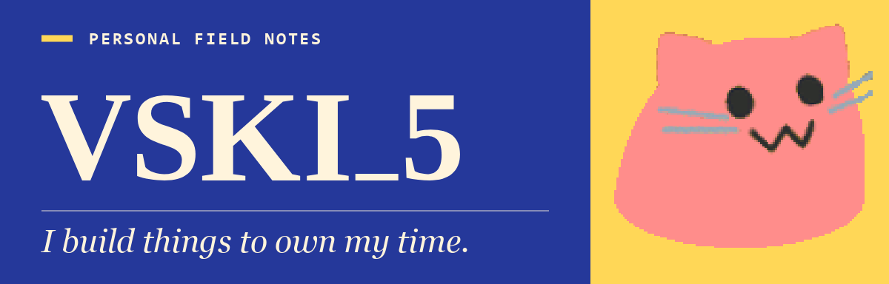

<h1>
  <picture>
    <source media="(prefers-reduced-motion: reduce) and (max-width: 640px)" srcset="./assets/readme/field-notes-compact.svg">
    <source media="(prefers-reduced-motion: reduce)" srcset="./assets/readme/field-notes.svg">
    <source media="(max-width: 640px)" srcset="./assets/readme/field-notes-compact.gif">
    
  </picture>
</h1>

I'm an independent builder. I make digital products and creative tools, and I learn by trying things out. I'm curious about AI and how it changes the tools I can build.

## Technical index

### Languages

    

### Front end

   

### Back end & databases

     

### Infrastructure & delivery

   

### AI & data science

     

### Development & automation

      

### AI-assisted development

   

### Systems & browsers

    

<details>
<summary>Technical index in plain text</summary>

- **Languages** · Python, Go, JavaScript, TypeScript, Bash
- **Front end** · HTML, CSS, React, Astro
- **Back end & databases** · Node.js, PocketBase, PostgreSQL, MySQL, Redis, SQLite
- **Infrastructure & delivery** · Docker, Kubernetes, Cloudflare, GitHub Actions
- **AI & data science** · PyTorch, TensorFlow, scikit-learn, NumPy, pandas, Jupyter Notebook
- **Development & automation** · Git, GitHub, Visual Studio Code, Vim, npm, PowerShell, FFmpeg
- **AI-assisted development** · OpenAI Codex, DeepSeek, AI agents, Agentic workflows
- **Systems & browsers** · Windows, Linux, Ubuntu, ChromeOS, Microsoft Edge

</details>

## Beyond code

I read economics to understand incentives, philosophy to question my assumptions, and history to see what has changed. Digital art and games give me other worlds to explore. Independent work gives me room to choose what to make next.

### Gaming


```
VSKI_5
```

*Technology is a means. Freedom is the end.*
