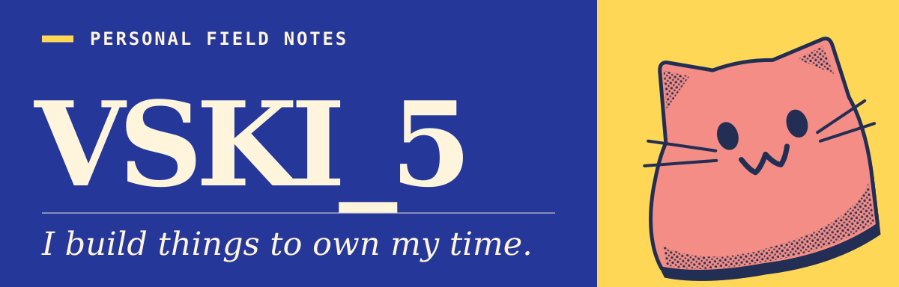

<h1>
  <picture>
    <source media="(max-width: 640px)" srcset="./assets/readme/field-notes-compact.svg">
    
  </picture>
</h1>

I'm an independent builder. I make digital products and creative tools, and I learn by trying things out. I'm curious about AI and how it changes the tools I can build.

## Technical index

###  Software

**Languages** · Python, Go, JavaScript, TypeScript, Bash\
**Front end** · HTML, CSS, React, Astro\
**Back end** · Node.js, PocketBase\
**Databases** · PostgreSQL, MySQL, Redis, SQLite

###  Systems & tooling

**Infrastructure** · Docker, Kubernetes, Nginx, Cloudflare\
**Version control & CI** · Git, GitHub, GitHub Actions\
**Editors & utilities** · Visual Studio Code, Vim, npm, PowerShell, FFmpeg\
**Operating systems** · Linux, Ubuntu, Windows, ChromeOS\
**Browser** · Microsoft Edge

###  AI & data

**Analysis & notebooks** · NumPy, pandas, Jupyter Notebook\
**Machine learning** · PyTorch, TensorFlow, scikit-learn\
**AI-assisted development** · OpenAI Codex, DeepSeek, AI agents and agentic workflows

## Beyond code

I read economics to understand incentives, philosophy to question my assumptions, and history to see what has changed. Digital art and games give me other worlds to explore. Independent work gives me room to choose what to make next.

### Gaming

 &nbsp; Steam ID &nbsp; **`VSKI_5`**

*Technology is a means. Freedom is the end.*
